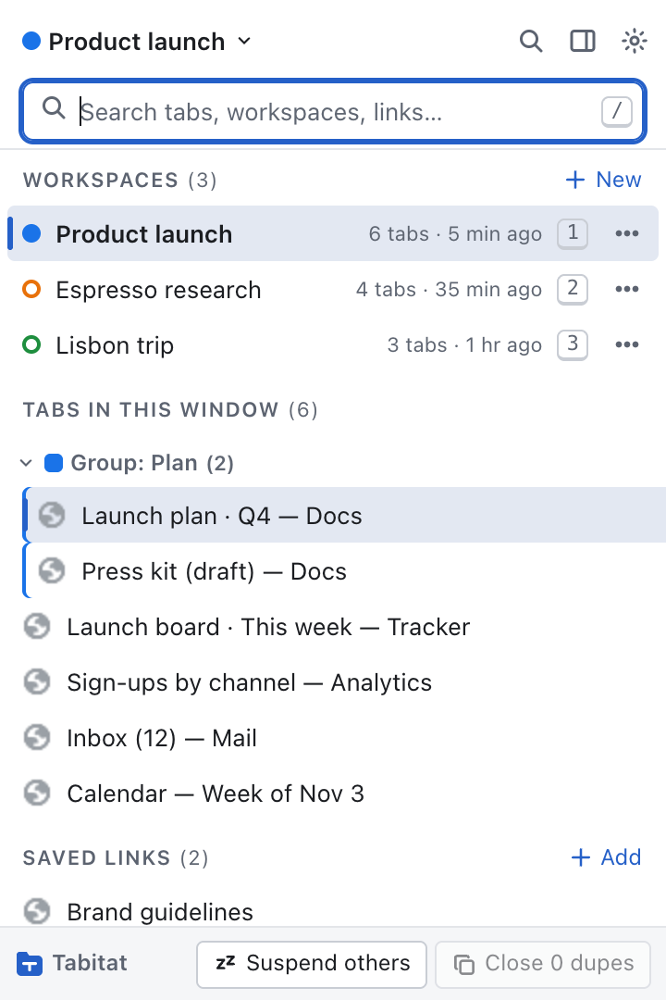

# Tabitat

Tabitat is a Chrome extension (Manifest V3) that groups your tabs into named workspaces. Switching
workspace saves the tabs of the one you leave and opens the saved tabs of the one you enter, so a
window shows one task at a time. It also has a side panel, a dashboard with todos, notes and a
pomodoro timer, and a safety net of session snapshots and a trash. Everything is stored in the
browser. Tabitat has no account, no server and makes no network requests.



## Features

**Popup and side panel** (the side panel has the same sections with more room)
- Workspaces: create from the current window or empty, switch, rename, set a color, open in a new
  window, delete (with undo; deleted items go to the trash).
- Search across open tabs, tabs saved in workspaces, saved links, quick links and recently closed
  tabs.
- Tabs in this window, with tab groups; park a tab as a saved link; close a tab with undo.
- Tab suspension: suspend one tab, or all other tabs in the window. Duplicate tabs are marked and
  can be closed in one click, with undo.
- Saved links per workspace, recently closed list (last 50).
- Side panel only: collapsible Todos, Notes and Pomodoro sections.
- Banners for interrupted switches, an unrestored window after a restart, and the backup reminder.

**Dashboard** (`dashboard.html`; also the new tab page in the "Tabitat New Tab" flavor)
- Clock and greeting, universal search (when nothing matches, Enter searches the web with your
  browser's default search engine), quick links grid, workspace cards.
- Todos and notes, global or per workspace; notes render a small markdown subset with no images.
- Pomodoro timer that keeps running when the page is closed and notifies at the end of a phase.
- Customize panel: widget toggles and order, theme, wallpaper (gradient, color, or an image stored
  on this device only).

**Options**
- General (theme, tabs restored per switch), Suspension (off by default, per-site exclusions),
  Sessions (snapshot interval and how many to keep), Pomodoro, Sync, Shortcuts, Bookmarks import,
  Data, About.
- Settings sync is opt-in and carries settings only (never tabs, notes or todos).
- Bookmarks import is optional: it asks for the `bookmarks` permission only when you start it and
  turns folders into quick links or workspaces.
- Data: JSON backup, bookmarks-format HTML export, backup reminder, trash, storage used, reset
  settings.

**Recovery** (`recovery.html`)
- Interrupted workspace switches, session snapshots (restore one into a new window, export as JSON
  or HTML), quarantined records, trash with restore and "Purged in N days", backup import (replace
  or merge; a replace import moves the previous workspaces to the trash).

**Welcome tour**: opens once after a fresh install; reopen it from Options, About.

Known limitation: closing a tab loses in-page state (scroll position, unsaved forms, history).
Tabitat saves and restores each tab's URL, title, group and order. Pinned tabs are never closed by
a switch; they stay with the window.

## Install

**Chrome Web Store:** [Tabitat](<chrome-web-store-url>) (coming soon).

**From a release zip**
1. Download `tabitat-<version>.zip` from the [Releases](<repo-url>/releases) page and unzip it.
2. Open `chrome://extensions` and turn on **Developer mode**.
3. Choose **Load unpacked** and select the unzipped folder.

**From source**
```sh
npm ci
npm run build              # -> .output/chrome-mv3
```
Then load `.output/chrome-mv3` with **Load unpacked** as above.

Requires Chrome (or another Chromium browser) 121 or later. See [COMPATIBILITY.md](COMPATIBILITY.md).

### Two flavors: install only one

| Flavor | Zip / build | Name | New tab page |
|---|---|---|---|
| Default | `tabitat-<version>.zip`, `npm run build` | Tabitat | not changed |
| New tab | `tabitat-newtab-<version>.zip`, `npm run build:newtab` -> `.output-newtab/chrome-mv3` | Tabitat New Tab | replaced by the dashboard |

They share one storage format and the same features; the new tab flavor only adds the new tab
override ([ADR-004](docs/adr/004-newtab-build-flavor.md)). Install one of them, not both. In the
default flavor the dashboard is still available from the popup and the side panel.

## Keyboard shortcuts

| Action | Windows / Linux | macOS | Default |
|---|---|---|---|
| Search tabs and workspaces | Ctrl+Shift+K | Command+Shift+K | assigned |
| Switch to next workspace | Ctrl+Shift+Period | Command+Shift+Period | assigned |
| Switch to previous workspace | Ctrl+Shift+Comma | Command+Shift+Comma | assigned |
| Suspend all other tabs in this window | not set | not set | unassigned |
| Open the side panel | not set | not set | unassigned |

Change them in Options, Shortcuts ("Change in Chrome"), or on your browser's extension shortcuts
page (`chrome://extensions/shortcuts` in Chrome). Browsers may refuse a key another extension owns.

## Privacy

Tabitat stores your workspaces, tabs, notes and todos in the browser's local extension storage and
sends nothing off the device except what you ask for: a web search you submit from the dashboard,
optional settings sync through the browser's own sync storage, and backups you download.
Production builds ship a content security policy with `connect-src 'none'`, so the browser itself
blocks network requests from extension pages and the service worker. There are no host
permissions, no content scripts and no analytics. Incognito windows are never tracked.
Details, permissions and data deletion: [PRIVACY.md](PRIVACY.md).

## Development

Node 24 (`fnm use` reads `.node-version`) and npm. The e2e tests need Google Chrome installed.

```sh
npm ci
npm run dev            # launches Chrome with HMR (npm run dev:newtab for the other flavor)
npm run check          # lint + typecheck + unit tests (+ i18n check)
npm run build && npm run e2e
```

Scripts: `dev`, `dev:newtab`, `build`, `build:newtab`, `zip`, `zip:newtab`, `lint`, `format`,
`typecheck`, `test`, `test:watch`, `e2e`, `budgets`, `i18n`, `assets`, `check`. The `:newtab`
scripts set `TABITAT_FLAVOR=newtab` inline, which works in macOS/Linux shells; on Windows use
WSL or set the variable first (PowerShell: `$env:TABITAT_FLAVOR="newtab"`). See
[CONTRIBUTING.md](CONTRIBUTING.md).

## Documentation

| Document | What it covers |
|---|---|
| [docs/ARCHITECTURE.md](docs/ARCHITECTURE.md) | Design, data model, switch state machine, privacy rules |
| [docs/adr/](docs/adr/) | Decision records (stack, placeholder restore, worker writes, new tab flavor) |
| [docs/UI-SPEC.md](docs/UI-SPEC.md), [PHASE3](docs/PHASE3.md), [PHASE4](docs/PHASE4.md), [PHASE5](docs/PHASE5.md) | Per-phase specs |
| [docs/SPIKE.md](docs/SPIKE.md) | Browser measurements that the design rests on |
| [docs/MANUAL-QA.md](docs/MANUAL-QA.md) | Release checklist for what automation cannot drive |
| [docs/RELEASE.md](docs/RELEASE.md) | How a release is made |
| [docs/I18N.md](docs/I18N.md) | Adding a locale |
| [docs/reviews/](docs/reviews/) | Review findings and triage per phase |
| [COMPATIBILITY.md](COMPATIBILITY.md), [PRIVACY.md](PRIVACY.md), [SECURITY.md](SECURITY.md), [CHANGELOG.md](CHANGELOG.md) | Project policies and history |
| [store/README.md](store/README.md) | Chrome Web Store listing text and assets |

## License

[MIT](LICENSE).
